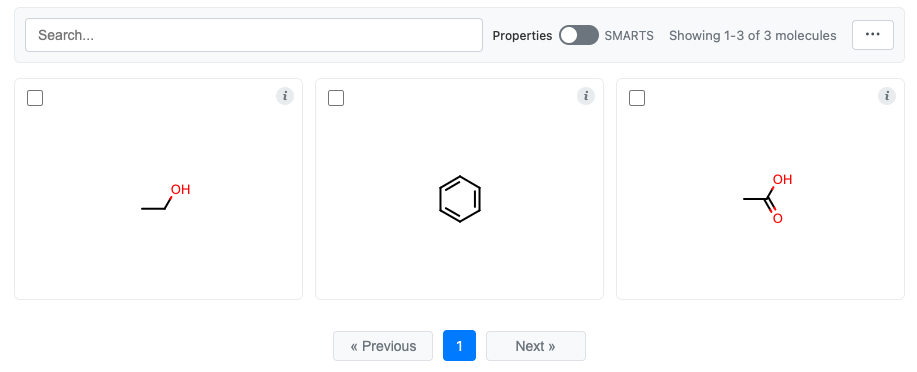
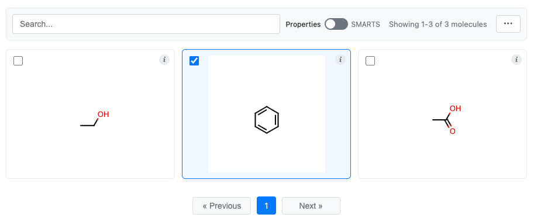
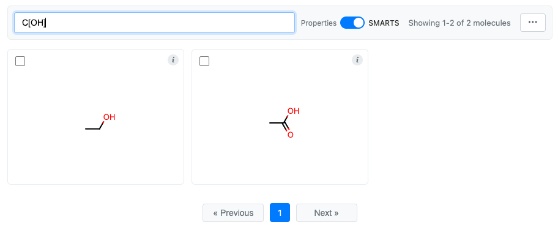
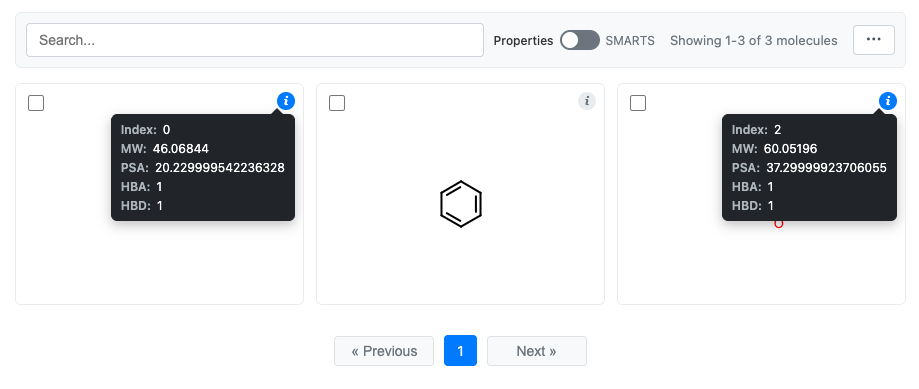
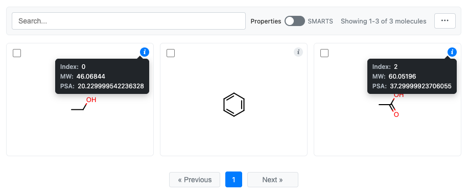
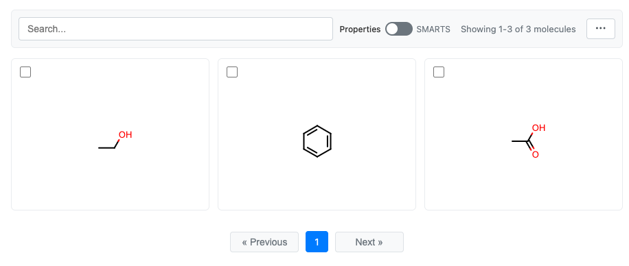
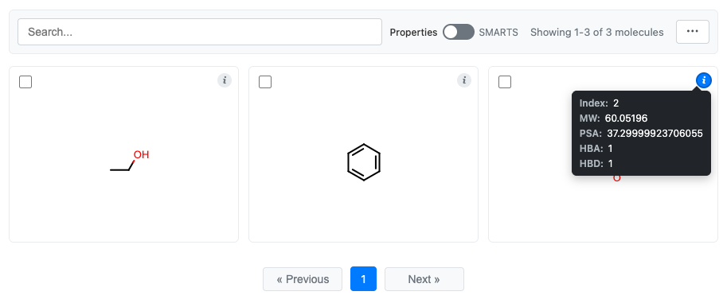
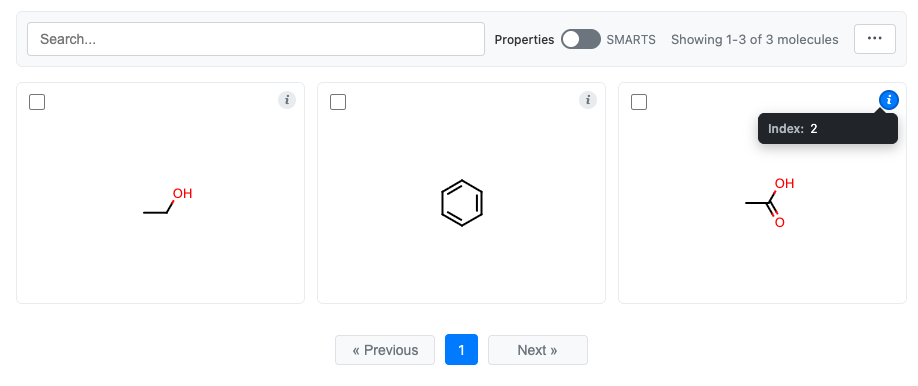
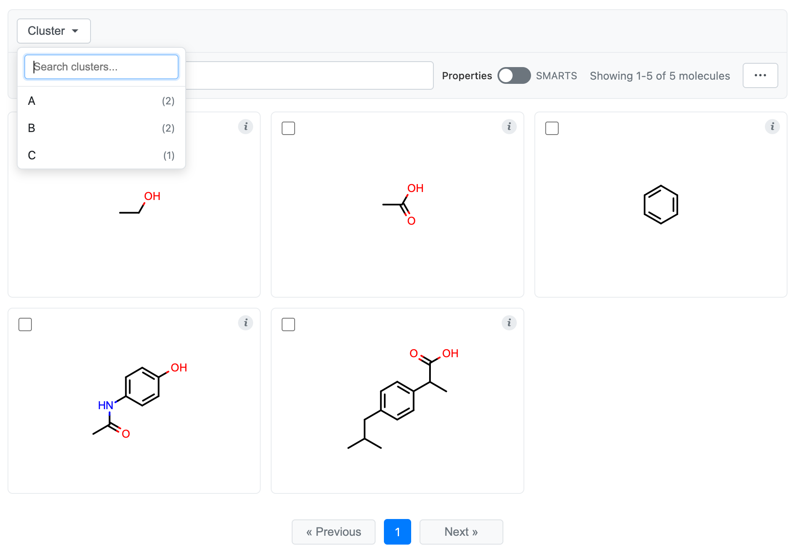
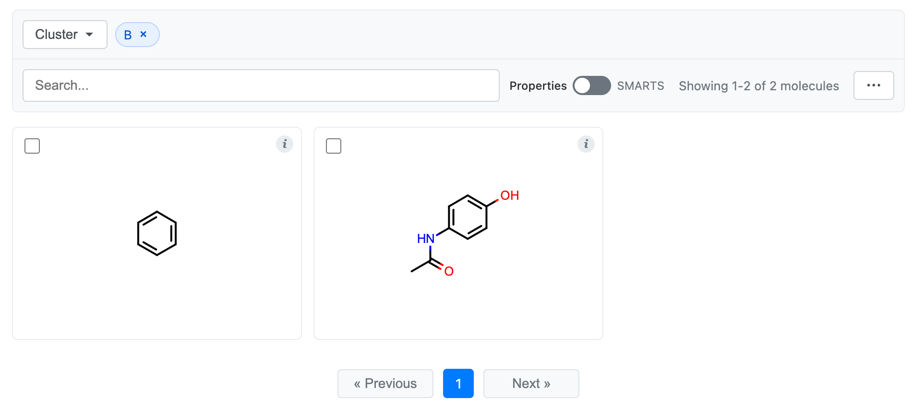

MolGrid: Interactive Molecule Grids
====================================

MolGrid provides an interactive grid visualization for browsing, searching, and
selecting molecules. It is designed for exploring large molecular datasets with
powerful filtering and selection capabilities.

Overview
--------

Key features of MolGrid:

- **Pagination**: Navigate large datasets with configurable items per page
- **Text Search**: Filter by molecule titles and properties
- **SMARTS Search**: Substructure filtering using SMARTS patterns
- **Selection**: Select molecules with checkboxes or click-to-select
- **Export**: Export selected molecules to SMILES or CSV files
- **Info Tooltips**: View molecular data with click-to-pin tooltips
- **DataFrame Integration**: Automatic field detection from DataFrames
- **Generic and SD Data**: Recognizes OpenEye generic data and/or SD data on molecules
- **Cluster Viewing**: Filter and browse molecules by cluster labels

Basic Usage
-----------

Creating a Simple Grid
^^^^^^^^^^^^^^^^^^^^^^

You can create a molecule grid from any iterable.

.. code-block:: python

    from cnotebook import MolGrid
    from openeye import oechem

    # Create molecules
    molecules = []
    for smi in ["CCO", "c1ccccc1", "CC(=O)O"]:
        mol = oechem.OEGraphMol()
        oechem.OESmilesToMol(mol, smi)
        molecules.append(mol)

    # Create and display grid
    grid = MolGrid(molecules)
    grid.display()

See :ref:`molgrid-class` for the complete list of options.

Selection
---------

You can select molecules and then retrieve the selections later in the same notebook.

Enabling Selection
^^^^^^^^^^^^^^^^^^

Selection is enabled by default:

.. code-block:: python

    grid = MolGrid(molecules, select=True)   # Enabled (default)
    grid = MolGrid(molecules, select=False)  # Disable molecule selection

Selection Methods
^^^^^^^^^^^^^^^^^

Multiple ways to select molecules:

1. **Click on a molecule** to toggle its selection
2. **Click the checkbox** in the top-left corner
3. **Use the Actions menu** ("..." button):

   - Select All: Select all visible molecules
   - Clear Selection: Deselect all molecules
   - Invert Selection: Toggle selection state of all visible molecules

Retrieving Selections
^^^^^^^^^^^^^^^^^^^^^

Let's make a selection in the simple molecule grid that we created above.

You can now retrieve the selection in two different ways:

.. code-block:: python

    # Get selected molecule objects
    selected_mols = grid.get_selection()
    print(f'Selected molecules: {", ".join(map(oechem.OEMolToSmiles, selected_mols))}')

    # Get selected indices
    indices = grid.get_selection_indices()
    print(f"Selected indices: {indices}")

This prints:

.. code-block:: text

    Selected molecules: c1ccccc1
    Selected indices: [1]

Exporting Selections
^^^^^^^^^^^^^^^^^^^^

Use the Actions menu to export selected molecules:

- **Copy to Clipboard**: Copy as CSV to clipboard
- **Save to SMILES**: Download as .smi file
- **Save to CSV**: Download as .csv file with all data columns

Customizing the Display
-----------------------

Image Settings
^^^^^^^^^^^^^^

Control the size and format of molecule images:

.. code-block:: python

    grid = MolGrid(
        molecules,
        width=150,                  # Image width in pixels
        height=150,                 # Image height in pixels
        image_format="svg",         # "svg" or "png"
        atom_label_font_scale=1.5,  # Scale factor for atom labels
    )

Pagination
^^^^^^^^^^

Control how many molecules appear per page:

.. code-block:: python

    grid = MolGrid(
        molecules,
        n_items_per_page=24,  # Molecules per page (default: 24)
    )

Title Display
^^^^^^^^^^^^^

Control molecule title display:

.. code-block:: python

    # Show titles from molecule's built-in title (default)
    grid = MolGrid(molecules, title=True)

    # Show titles from SD data field
    grid = MolGrid(molecules, title="Name")

    # Hide titles
    grid = MolGrid(molecules, title=None)

Search and Filtering
--------------------

MolGrid provides two search modes accessible via the toggle in the toolbar:

Text Search
^^^^^^^^^^^

Search across molecule titles and configured search fields:

.. code-block:: python

    # Configure which fields are searchable
    grid = MolGrid(
        molecules,
        search_fields=["Name", "Category"],
    )

When using a DataFrame, string columns are automatically detected as searchable.

SMARTS Mode (Substructure Search)
^^^^^^^^^^^^^^^^^^^^^^^^^^^^^^^^^

Filter molecules by SMARTS substructure patterns. Switch to SMARTS mode using
the toggle in the toolbar, then enter a SMARTS pattern.

Info Button and Tooltips
------------------------

Each molecule cell has an info button ("i") in the top-right corner.

- **Hover** over the "i" to see the tooltip
- **Click** the "i" to pin the tooltip open
- **Click again** to unpin

This allows comparing data across multiple molecules by pinning multiple tooltips.

Here is an example using a DataFrame:

.. code-block:: python

    import pandas as pd
    from cnotebook import MolGrid
    from openeye import oechem, oemolprop

    # Create DataFrame
    df = pd.DataFrame(
        {"Molecule": ["CCO", "c1ccccc1", "CC(=O)O"]}
    ).chem.as_molecule("Molecule")

    # Calculate some properties
    df["MW"] = df.Molecule.apply(oechem.OECalculateMolecularWeight)
    df["PSA"] = df.Molecule.apply(oemolprop.OEGet2dPSA)
    df["HBA"] = df.Molecule.apply(oemolprop.OEGetHBondAcceptorCount)
    df["HBD"] = df.Molecule.apply(oemolprop.OEGetHBondDonorCount)

    # Display the grid (using the 'Molecule' column for structures)
    grid = df.chem.molgrid("Molecule")
    grid.display()

Clicking the "i" for the first and last molecules:

Configuring Displayed Data
^^^^^^^^^^^^^^^^^^^^^^^^^^

Control what appears in the info tooltip using the ``data`` parameter:

.. code-block:: python

    # Display the grid and only show MW and PSA
    grid = df.chem.molgrid("Molecule", data=["MW", "PSA"])
    grid.display()

The tooltip always displays:

1. **Index**: The molecule's position in the grid
2. **Title**: The molecule's title (if set)
3. **Data fields**: Additional fields from the ``data`` parameter

Disabling the Info Button
^^^^^^^^^^^^^^^^^^^^^^^^^

You can remove the info button if you don't want to see it.

.. code-block:: python

    grid = MolGrid(molecules, information=False)

DataFrame Integration
---------------------

Pandas
^^^^^^

Pandas has both ``DataFrame``-level and ``Series``-level accessors for displaying molecule grids. The
``DataFrame``-level accessor will include other data from the ``DataFrame``, the ``Series``-level accessor will not.

Here is the same example as above:

.. code-block:: python

    import pandas as pd
    from cnotebook import MolGrid
    from openeye import oechem, oemolprop

    # Create DataFrame
    df = pd.DataFrame(
        {"Molecule": ["CCO", "c1ccccc1", "CC(=O)O"]}
    ).chem.as_molecule("Molecule")

    # Calculate some properties
    df["MW"] = df.Molecule.apply(oechem.OECalculateMolecularWeight)
    df["PSA"] = df.Molecule.apply(oemolprop.OEGet2dPSA)
    df["HBA"] = df.Molecule.apply(oemolprop.OEGetHBondAcceptorCount)
    df["HBD"] = df.Molecule.apply(oemolprop.OEGetHBondDonorCount)

    # Display the grid
    grid = df.chem.molgrid("Molecule")
    grid.display()

You can see that all the data has accompanied the molecules in the grid:

This is not the case with the ``Series-level`` accessor. It will just show the molecules:

.. code-block:: python

    # Display the grid
    grid = df.Molecule.chem.molgrid()
    grid.display()

Automatic Field Detection
^^^^^^^^^^^^^^^^^^^^^^^^^

When using a DataFrame, MolGrid automatically detects:

- **Search fields**: String columns for text search
- **Info fields**: All simple type columns (string, int, float) for the info tooltip

.. code-block:: python

    import pandas as pd
    from cnotebook import MolGrid
    from openeye import oechem, oemolprop, oeiupac

    # Create DataFrame
    df = pd.DataFrame(
        {"Molecule": ["CCO", "c1ccccc1", "CC(=O)O"]}
    ).chem.as_molecule("Molecule")

    # Add the IUPAC name
    df["IUPAC"] = df.Molecule.apply(oeiupac.OECreateIUPACName)

    # Calculate some numerical properties
    df["HBA"] = df.Molecule.apply(oemolprop.OEGetHBondAcceptorCount)
    df["HBD"] = df.Molecule.apply(oemolprop.OEGetHBondDonorCount)

    # Create the grid
    grid = df.chem.molgrid("Molecule")

    # Check what was auto-detected
    print(f"Search fields: {grid.search_fields}")
    print(f"Info fields: {grid.information_fields}")

You can see that only the string ``"IUPAC"`` column is searched.

.. code-block:: text

    Search fields: ['IUPAC']
    Info fields: ['IUPAC', 'HBA', 'HBD']

Viewing Clusters
----------------

If your DataFrame has cluster labels (or if they are attached to your molecules as SD or OpenEye generic data), then
you can configure the molecule grid for cluster browsing by providing the ``cluster`` parameter.

.. code-block:: python

    import cnotebook
    import pandas as pd
    from openeye import oechem

    # Example data
    df = pd.DataFrame({
        "Molecule": ['CCO', 'CC(=O)O', 'c1ccccc1', 'CC(=O)Nc1ccc(O)cc1',
                     'CC(C)Cc1ccc(C(C)C(=O)O)cc1'],
        "Name": ['Ethanol', 'Acetic Acid', 'Benzene', 'Acetaminophen', 'Ibuprofen'],
        "Cluster": ['A', 'A', 'B', 'B', 'C']  # Can be any type
    }).chem.as_molecule("Molecule")

    # Create the grid specifying that "Cluster" contains cluster labels
    grid = df.chem.molgrid("Molecule", cluster="Cluster")

    # Display the grid
    grid.display()

You'll now see a dropdown at the top that allows you to search and select cluster labels to view. Selecting a cluster
will only show members of that cluster, and selecting multiple clusters will show the union of those clusters. Search will
only search within the clusters that you have selected. Similarly, selections from the "..." menu (e.g., "Select All")
will only apply to the selected clusters.

Selecting cluster label "B":

Badges and sorting
------------------

Badges show a field's value as a chip on each card, and ``sort_by`` sets the field the
grid is sorted on when it first appears. Both take field names, which are the columns of
the DataFrame the grid was built from.

.. code-block:: python

    grid = df.chem.molgrid(
        "Molecule",
        badges=["MW"],
        sort_by=("MW", True),
    )
    grid.display()

``sort_by`` accepts a bare field name for an ascending sort, or a ``(field, descending)``
pair. ``sort_by=("MW", True)`` sorts on ``MW``, largest first. The sort control in the
grid header still works; ``sort_by`` only chooses where it starts.

Themes
------

``theme`` is ``"auto"``, ``"light"`` or ``"dark"``, and defaults to the configured
``molgrid.theme`` (``"auto"`` unless a configuration file says otherwise). Under
``"auto"`` the grid follows the notebook: it reads JupyterLab's ``--jp-layout-color1``
from the host document and classifies it by luminance, and outside JupyterLab, where
there is no such variable, it falls back to the ``prefers-color-scheme`` media query.
The theme is resolved when the grid renders, so switch the lab theme before displaying
the grid. ``"light"`` and ``"dark"`` pin the grid regardless of the notebook.

.. code-block:: python

    grid = df.chem.molgrid("Molecule", theme="dark")
    grid.display()

An unknown theme raises ``ValueError``.

Selections as DataFrames
------------------------

When the grid was built from a DataFrame, ``selection_frame()`` returns the selected rows
as a frame of the same kind, in index order, with every column the source frame had.

.. code-block:: python

    grid = df.chem.molgrid("Molecule")
    grid.display()

    # ... tick some cards in the grid ...

    selected = grid.selection_frame()
    print(selected.shape)

``get_selection()`` returns the selected molecules and ``get_selection_indices()`` the
positions, and both work for a grid built from a plain list of molecules.
``selection_frame()`` raises ``CNotebookError`` on a grid that has no source DataFrame.

Cluster labels
--------------

``cluster`` accepts three forms:

- a **column name** of the source DataFrame, as in the example above;
- a **sequence** of one label per molecule, in the order the molecules were passed, which
  is the form to use for a grid built from a plain list;
- a **mapping** of ``{index: label}``, which labels only the molecules it names.

.. code-block:: python

    from cnotebook import molgrid

    # One label per molecule
    grid = molgrid(molecules, cluster=["A", "A", "B", "B", "C"])

    # Or label only some of them
    grid = molgrid(molecules, cluster={0: "A", 1: "A", 2: "B"})

Molecules with no label are collected under ``"Uncategorized"``. A sequence whose length
does not match the molecules, or a column name the DataFrame does not have, raises
``ValueError``; anything that is not a name, a sequence or a mapping raises ``TypeError``.

Static export
-------------

A grid displays as a live widget by default, which keeps the notebook output small and
needs a running kernel. For output that survives without one, ask for the static form:

.. code-block:: python

    grid.display(static=True)     # self-contained HTML in the notebook output
    html = grid.to_html()         # the same document as a string
    grid.save("grid.html")        # written to a file

A static document embeds every image, the front-end module and the stylesheet, so it
works from a file, an attachment or a static web server and makes no network requests.
That also makes it large: ``to_html()`` emits a ``CNotebookWarning`` above
``static_max_items`` molecules (default 2000). Raise the limit if the size is expected:

.. code-block:: python

    grid = df.chem.molgrid("Molecule", static_max_items=5000)

``configure(display_mode="static")``, or ``mode = "static"`` under ``[display]`` in the
configuration file, makes ``display()`` produce the static form without the argument.

API Reference
-------------

.. _molgrid-class:

MolGrid Class
^^^^^^^^^^^^^

.. autoclass:: cnotebook.grid.MolGrid
   :members: display, to_html, save, get_selection, get_selection_indices, selection_frame, set_render_options, close
   :no-index:

molgrid Function
^^^^^^^^^^^^^^^^

.. autofunction:: cnotebook.grid.molgrid
   :no-index:

The canonical entries, with every member, are on the :doc:`api/molgrid` page; these two
carry ``:no-index:`` so the cross-references resolve there.
